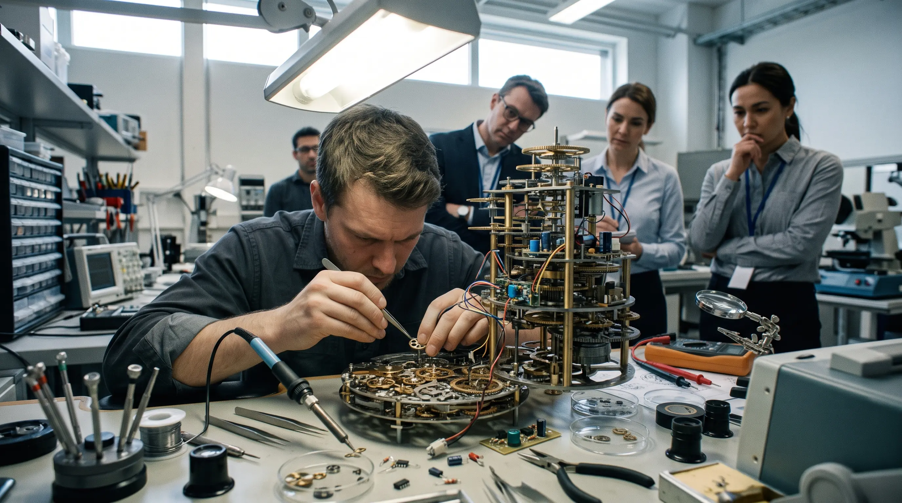

### Subagentes, Skills, MCP, hooks y calibración de modelo: cómo Claude convierte un LLM que predice el siguiente token en algo que percibe, decide y actúa — pieza por pieza.

*por Camilo — Octubre 2026 · [LinkedIn](https://www.linkedin.com/in/ernestocamilovera/)*

---

Imaginemos el experimento más simple posible: abrís una conversación con un LLM, le das un objetivo ambicioso — "migrá este módulo, actualizá los tests, escribí el changelog" — y le decís que no te consulte en el medio, que simplemente itere hasta terminar. Durante un rato funciona. Después empieza a releer archivos que ya había leído, a repetir una verificación que ya había hecho, a perder de vista una decisión que tomó quince turnos atrás porque ya no entra en lo que tiene fresco en la cabeza. El resultado no es un agente: es un chat largo, caro y cada vez más confundido, con la paciencia de no pedirte permiso.

Ese experimento fallido es útil porque muestra, por el lado equivocado, exactamente dónde está el problema. En la [entrega anterior de esta serie](/my-articles/agentes-agentes-agentes/) quedó planteada la idea de que **el modelo tampoco es el agente** — que lo que convierte a un LLM en algo que percibe, decide y actúa no es su tamaño ni su versión, sino el harness que lo rodea: el loop de reunir contexto, actuar y verificar. Lo que faltaba era abrir ese harness y mirar las piezas por separado. Esta entrega hace eso, usando como caso la implementación de Claude — no porque sea la única manera de resolverlo, sino porque es la que tengo documentada con más detalle, y porque las piezas que expone son, con nombres distintos, las mismas que aparecen en cualquier arquitectura agéntica seria.

## El problema real no es "darle más herramientas"

Antes de entrar pieza por pieza, vale la pena nombrar el error de diseño que el experimento del principio ilustra: tratar la ventana de contexto como si fuera memoria infinita. Un LLM no "recuerda" nada fuera de lo que está en su contexto en ese instante — y ese contexto compite por espacio entre el objetivo original, el historial completo de la conversación, el contenido de cada archivo leído y el resultado de cada herramienta ejecutada. Un agente generalista no se vuelve caro ni lento porque sea "menos inteligente" que uno especializado; se vuelve caro porque **acumula responsabilidad con el tiempo** — cada nueva capacidad que le agregás (una herramienta más, un dominio más, una excepción más a la regla) se suma al mismo contexto que ya está compitiendo por espacio con todo lo anterior.

La respuesta de la industria a ese problema, documentada por Anthropic desde fines de 2024 en ["Building Effective Agents"](https://www.anthropic.com/engineering/building-effective-agents), es un bloque de construcción que llaman el **LLM aumentado**: un modelo al que se le agregan recuperación de información, herramientas y memoria, con el propio modelo decidiendo cuándo y cómo usar cada una. Sobre ese bloque se apilan patrones de orquestación — encadenamiento de prompts, enrutamiento, paralelización, orquestador-trabajadores, evaluador-optimizador — que son, hoy, lo más parecido a un estándar de facto que tiene el campo. Claude no inventa ninguno de estos patrones. Lo que vale la pena mirar es cómo los traduce en piezas concretas que podés tocar.

## Subagentes: aislar el contexto, no solo repartir el trabajo

La pieza más visible es el subagente: un asistente separado, con su propio prompt de sistema, su propia lista de herramientas permitidas y, sobre todo, **su propia ventana de contexto**, aislada de la conversación principal. Un subagente no hereda el historial de lo que ya se discutió ni los archivos que ya se leyeron — recibe una consigna puntual, hace su trabajo en su propio espacio y devuelve solo el resumen que importa. Eso es lo que evita el colapso del experimento inicial: en vez de que todo compita por el mismo contexto, cada exploración costosa — revisar un error, auditar cien archivos, correr una batería de tests — vive y muere en su propio compartimento, y lo único que entra a la conversación principal es la conclusión.

Esto no es gratis, y la propia Anthropic lo cuantifica sin maquillaje: un agente individual consume en promedio unas **4 veces más tokens que un chat normal**, y un sistema multi-agente llega a **15 veces más**, según ["How we built our multi-agent research system"](https://www.anthropic.com/engineering/multi-agent-research-system). El mismo paper es honesto sobre cuándo ese costo se justifica y cuándo no: vale la pena cuando la tarea tiene valor suficiente para pagar el extra, cuando hay partes genuinamente paralelizables, o cuando la información a procesar excede lo que entra en una sola ventana de contexto — búsquedas exploratorias en paralelo son el ejemplo de libro. No vale la pena cuando las partes del problema dependen tan fuerte entre sí que terminás pagando por coordinación en vez de por trabajo útil — y el propio paper señala que la mayoría de las tareas de programación tienen muchas menos partes paralelizables que, por ejemplo, una investigación abierta. Dicho de otro modo: especializar es una decisión de diseño deliberada, con un costo que hay que poder justificar, no un default que se activa solo porque "dos cabezas piensan mejor que una".

El diseño de Claude refleja esa cautela de otra forma, además del costo: por defecto hay un límite de subagentes concurrentes (ajustable, pero existe) y un límite de **hasta tres niveles de anidamiento** — un subagente puede lanzar sus propios subagentes, pero no hasta el infinito. La regla de oro que viene de la literatura de patrones de orquestación — especializar al trabajador, mantener al orquestador lo bastante general como para descomponer bien el problema — se traduce acá en un límite concreto en el código, no solo en una recomendación de diseño.

## Skills: conocimiento de procedimiento, cargado solo cuando hace falta

Si los subagentes resuelven el aislamiento, las Skills resuelven un problema distinto: cómo le das a un agente instrucciones detalladas y reutilizables — un checklist, un procedimiento de varios pasos, el formato exacto de un archivo que necesita generar — sin que esas instrucciones vivan permanentemente en el contexto, compitiendo por espacio incluso cuando no hacen falta.

Una Skill es, en esencia, una carpeta con un archivo `SKILL.md`: una descripción corta que el agente siempre puede ver, y un cuerpo de instrucciones que solo se carga cuando la Skill efectivamente se activa. Es **divulgación progresiva** aplicada a instrucciones en vez de a datos: la descripción cuesta casi nada y está siempre disponible para que el agente sepa que la Skill existe; el contenido completo — que puede incluir archivos de referencia adicionales, cargados a su vez solo si el agente los necesita — entra al contexto únicamente en el momento en que se usa. Es la diferencia entre un archivo de reglas que el agente tiene que releer en cada turno exista o no la necesidad, y un manual que se abre en la página correcta solo cuando hace falta consultarlo.

La frontera entre una Skill y un subagente es más sutil de lo que parece a primera vista, y vale la pena marcarla porque se presta a confusión: una Skill no es, por default, un agente separado — es contenido que se inyecta en la conversación que ya está corriendo. Solo cuando una Skill se configura explícitamente para correr en un contexto aislado (lo que en la implementación de Claude se declara como `context: fork`) termina ejecutándose como si fuera un subagente. El resto del tiempo, Skill y subagente resuelven el mismo problema de fondo — evitar que todo compita por el mismo contexto todo el tiempo — desde ángulos distintos: uno aísla *ejecución*, el otro aísla *conocimiento*.

## MCP: la interfaz agente-herramienta como problema de diseño en sí mismo

La entrega anterior ya presentó el Model Context Protocol como el "USB-C de las aplicaciones de IA" — el estándar, publicado por Anthropic en noviembre de 2024, que evita que cada integración con una herramienta externa se reinvente desde cero. Lo que falta agregar acá es la mecánica: un servidor MCP anuncia sus herramientas con un nombre, una descripción y un esquema de entrada; el agente decide cuándo le conviene usar cada una; el resultado vuelve al agente como cualquier otra respuesta de herramienta. No hay magia adicional — es el mismo tool calling de siempre, con un contrato común en el medio.

Lo interesante es un matiz que suele pasar desapercibido: cómo se documenta y describe cada herramienta MCP termina siendo tan determinante como la herramienta misma. En la literatura de diseño de agentes esto tiene nombre propio — **ACI**, *Agent-Computer Interface*, por analogía directa con HCI — y la idea central es que una herramienta mal descripta, con ejemplos ambiguos o límites poco claros, le hace tomar peores decisiones a un agente perfectamente capaz, exactamente igual que una interfaz mal diseñada confunde a un usuario humano competente. El propio diseño de Claude lo refleja en un detalle operativo muy concreto: un resultado de herramienta MCP que supera los 10.000 tokens dispara una advertencia, y por default se trunca en 25.000 — no porque el modelo no pueda procesar más texto, sino porque un resultado gigante sin curar es, en la práctica, una interfaz mal diseñada que ahoga el resto del contexto con ruido que nadie va a releer.

## Hooks: la garantía que el prompt no puede dar

Las tres piezas anteriores le dan forma al *qué* puede hacer un agente. Los hooks resuelven una pregunta distinta: cómo garantizás que ciertas reglas se cumplan **siempre**, sin depender de que el modelo decida obedecerlas ese turno en particular.

Una instrucción en el prompt de sistema — "nunca borres archivos sin confirmar", "corré el linter después de cada cambio" — es una petición que el modelo lee y, en general, respeta. Pero compite por atención con todo lo demás que hay en el contexto, y un modelo bajo presión puede olvidarla, interpretarla de forma distinta a la intención original, o decidir — con buena fe — que esta situación particular es la excepción. Un hook no es una petición: es código que el harness ejecuta de forma determinística cada vez que ocurre el evento que lo dispara — antes de que se ejecute una herramienta (`PreToolUse`), después de que termina (`PostToolUse`), al iniciar una sesión, al recibir un prompt. El modelo no decide si el hook corre; si el hook bloquea la acción, la acción no sucede, haya tenido el modelo una buena razón o no.

Esta distinción — guía basada en prompt versus garantía basada en código — es la versión concreta de algo que la literatura de patrones agénticos viene señalando desde hace rato: el control y las barreras de contención se están volviendo, cada vez más, máquinas de estado explícitas en vez de flujo de control librado al LLM, justamente para poder insertar un punto de aprobación humana — o una verificación automática no negociable — antes de una acción irreversible. Es también, dicho sea de paso, la base técnica de un principio que vengo repitiendo en esta misma serie de posts sobre el desarrollo de una app con agentes bajo gobernanza: **verificar no es lo mismo que confiar en que el modelo diga que verificó.** Un hook que corre un test después de cada cambio de código no le pregunta al agente si el test pasó — lo corre él mismo y lee el resultado.

## Granularidad: la pregunta que no tiene una respuesta universal

Con las cuatro piezas sobre la mesa, queda la pregunta que las atraviesa a todas: ¿qué tan chico tiene que ser un subagente, una Skill, una herramienta? ¿Dónde está el límite entre "bien especializado" y "fragmentado al punto de generar más coordinación que valor"?

No hay un número mágico, pero sí hay un criterio que se repite en la literatura y que vale más que cualquier regla de pulgar: **la frontera de aislamiento es la decisión real, no la etiqueta de la topología que uses para nombrarla.** Lo que hace que la paralelización funcione — en los subagentes de Claude, en el sistema de investigación multi-agente de Anthropic, en cualquier arquitectura orquestador-trabajadores — es que los trabajadores no se hablan entre sí; toda decisión de coordinación vive en el orquestador. Eso es lo que permite que corran en paralelo sin pisarse. Y esa misma propiedad es la que falla cuando la tarea tiene demasiadas dependencias cruzadas: ya lo mencioné en la sección de subagentes, pero vale remarcarlo acá como principio de diseño general, no como anécdota de costo — programar, depurar, y en general cualquier flujo de trabajo fuertemente acoplado, es territorio hostil para la fragmentación en paralelo, precisamente porque las partes necesitan verse entre sí todo el tiempo. Ahí, un encadenamiento secuencial de pasos — o, como mucho, un ciclo evaluador-optimizador con una sola instancia revisando a otra — rinde mejor que forzar un reparto en workers aislados que de todas formas van a necesitar comunicarse.

La consecuencia práctica es incómoda pero útil: el tamaño correcto de un subagente o una Skill no se decide mirando cuánto hace, sino mirando **cuánto necesita saber de lo que hacen las demás piezas para hacer bien su parte.** Si la respuesta es "casi nada", aislarlo es gratis. Si la respuesta es "bastante", aislarlo cuesta más en coordinación de lo que ahorra en paralelismo — y ahí conviene mantenerlo adentro del mismo contexto, aunque eso signifique un agente menos "elegante" sobre el papel.

## Calibración de modelo: el enrutamiento como parte del diseño, no como ahorro de último momento

La última pieza es la más fácil de subestimar porque parece puramente administrativa: qué modelo corre cada parte del agente. Tanto los subagentes como las Skills de Claude permiten declarar qué modelo usa cada uno — el mismo que maneja la conversación principal, o uno más liviano y más barato para el trabajo de bajo riesgo. Esto es, en esencia, el patrón de **enrutamiento** de la lista de workflows de Anthropic aplicado dentro de un mismo agente en vez de entre agentes distintos: clasificar la dificultad de la tarea y mandarla al modelo que le corresponde, en lugar de correr todo con el modelo más caro disponible por default.

La razón por la que esto importa más de lo que parece está en los números que arroja el único intento serio que conozco de medir esto con disciplina, el framework **CLEAR** (Costo, Latencia, Eficacia, Garantía, Confiabilidad) de 2025: optimizar solo por precisión, ignorando el resto, puede terminar costando entre 4,4 y 10,8 veces más caro, y una ganancia de apenas dos puntos de precisión puede significar más de 50.000 dólares extra cada diez mil tareas. Ese no es un detalle de infraestructura — es la diferencia entre un agente que es viable en producción y uno que es una demo cara. Calibrar qué modelo corre cada pieza del harness no es optimización prematura: es la parte del diseño que decide si el resto de las piezas — subagentes bien aislados, Skills bien granuladas, hooks bien puestos — termina siendo sostenible o un experimento de un solo uso.

## Lo que queda después de abrir la caja

Ninguna de estas cinco piezas es exclusiva de Claude, y esa es exactamente la idea: no es investigación de punta, es consenso de industria ya documentado, que Claude implementa con nombres y límites concretos que se pueden mirar y tocar. Lo que cambia entre "un chat con más paciencia" y un agente bien diseñado no es ninguna pieza por separado — es que las cinco respondan a una misma pregunta de diseño, resuelta a conciencia en cada caso: qué necesita aislamiento propio (subagentes), qué necesita cargarse solo cuando hace falta (Skills), qué necesita un contrato estándar con el mundo exterior (MCP), qué necesita una garantía que ningún prompt puede dar (hooks), y qué tan grande tiene que ser cada pieza y con qué modelo corre, antes de que el costo se coma el beneficio.

Un wrapper frágil disfrazado de autonomía es, casi siempre, el mismo problema del experimento con el que arrancó este post, solo que con más herramientas conectadas: todo compitiendo por el mismo contexto, sin ninguna de estas cinco preguntas respondida a propósito. Entender esto no resuelve todavía la pregunta que viene después, que es menos técnica y más incómoda: qué cambia — en gobernanza, en costo real, en madurez de la práctica — cuando estos agentes bien diseñados dejan el playground y entran en producción, con presupuesto, auditoría y gente de verdad del otro lado. Esa es la conversación que esta serie todavía tiene pendiente.
